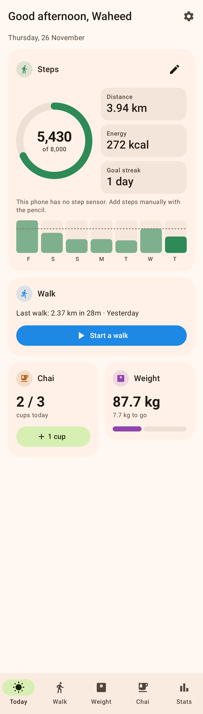
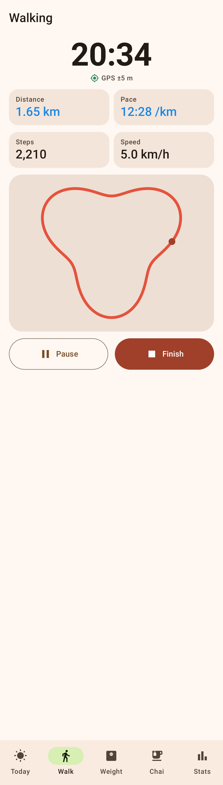
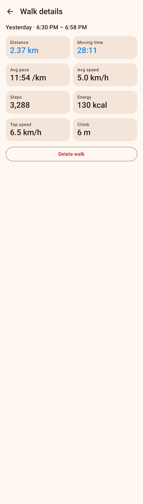
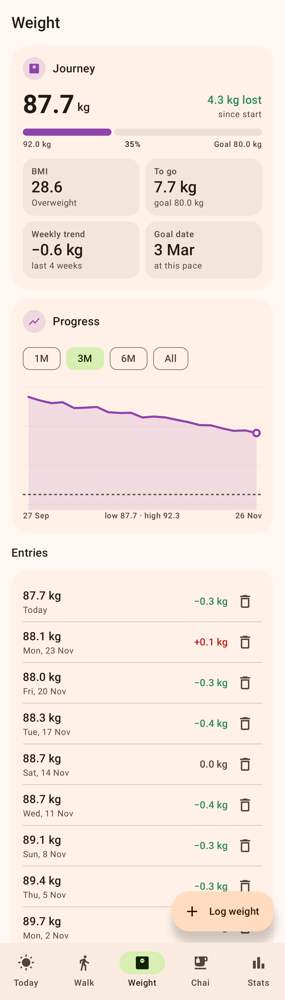
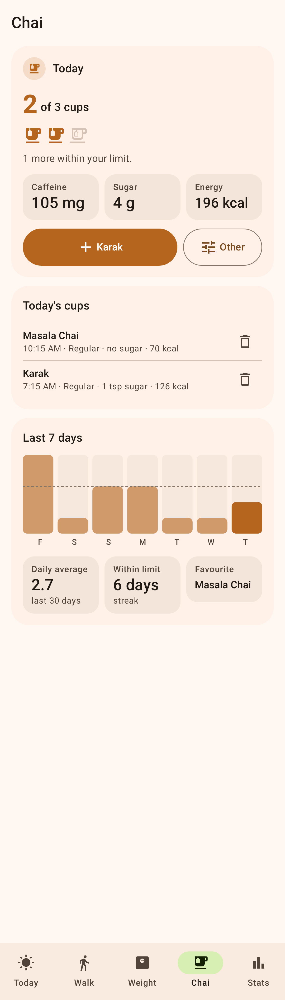
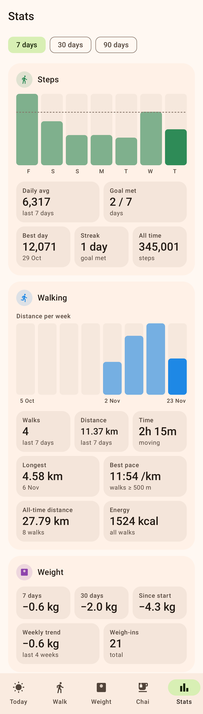

# Chai & Steps ☕👣

An Android app for a weight-loss journey: daily steps, recorded walks with GPS routes, walking stats,
weight progress, and how much chai you drink. Everything stays on your phone.

## Features

| Area | What it does |
|---|---|
| **Today** | Step ring vs. your goal (distance and energy estimated from steps), goal streak, a 7-day step chart, quick +1 chai, weight vs. goal, start a walk |
| **Steps** | Counted by the phone's step sensor, also in the background (synced every 15 min, reboot-safe). You can add steps or set a day's total by hand |
| **Walks** | A foreground service records the GPS route, distance, moving time (pauses excluded), pace, speed, steps, climb and calories, and keeps running with the screen off. Pause, resume, finish or discard from the app or the notification. A walk interrupted by the system is recovered |
| **Routes** | Every walk's route on an OpenStreetMap map (no API key needed). The live map follows you during a walk |
| **Weight** | Log weigh-ins (one per day, any date) with notes. Shows progress from start to goal, BMI, 4-week trend, projected goal date, and a chart (1M / 3M / 6M / All) |
| **Chai** | One-tap add of your usual chai, or pick the type (Karak, Doodh Patti, Masala, Sulaimani, Green…), cup size and sugar. Shows daily limit, caffeine, sugar, calories, 7-day chart, streak within your limit |
| **Stats** | 7 / 30 / 90-day steps, weekly walking distance, totals, longest walk and best pace, weight changes, chai averages |
| **Settings** | Profile, goals, kg/lb and km/mi, chai preferences, JSON backup export/import (including routes) |

Light and dark themes, Android 8.0 (API 26) and up.

## Install

Download `ChaiSteps-<version>.apk` from the latest [Release](../../releases) (or from a workflow
run's artifacts), open it on your phone and allow installing from that source.

On first use, allow **Physical activity** (steps), **Location** (walk routes) and **Notifications**
(the walk-in-progress notification). For reliable background step sync on some phones, set the app's
battery usage to *Unrestricted*.

## Build

```bash
./gradlew :app:testDebugUnitTest   # unit + Robolectric UI tests (screenshots in app/build/screenshots)
./gradlew :app:lintRelease
./gradlew :app:assembleRelease     # app/build/outputs/apk/release/app-release.apk
```

Requires JDK 17+ and the Android SDK (platform 35).

### Release signing

The release build is signed with the key in `keystore.properties` (git-ignored) or with these
environment variables, which CI reads from repository secrets:

| Secret | Value |
|---|---|
| `SIGNING_KEYSTORE_BASE64` | `base64 -w0 chaisteps-release.jks` |
| `SIGNING_STORE_PASSWORD` | keystore password |
| `SIGNING_KEY_ALIAS` | `chaisteps` |
| `SIGNING_KEY_PASSWORD` | key password |

Without the secrets, CI signs with a temporary debug key and warns about it. Keep the keystore safe:
updates to an installed app must be signed with the same key.

## CI

`.github/workflows/android.yml` runs tests, lint and the signed release build on every push and pull
request and uploads the APK and screenshots. A push to `main` (for example merging a pull request)
also publishes a GitHub Release with the APK.

## Architecture

- Kotlin, Jetpack Compose, Material 3, Navigation Compose
- `data/`: models (kotlinx.serialization) and `Repository`, a single `StateFlow` saved atomically to a
  JSON file with a backup copy. Routes are stored one file per walk
- `domain/`: pure logic, unit tested: step-counter accounting, GPS filtering (accuracy, jitter, jumps),
  fitness maths, statistics, formatting
- `tracking/`: `WalkRecorder` (pure walk logic), `WalkService` (foreground location service),
  `StepSensorMonitor` and `StepSyncWorker` (WorkManager)
- `ui/`: screens and canvas charts; maps via osmdroid

## Screenshots

| Today | Walk | Route | Weight | Chai | Stats |
|---|---|---|---|---|---|
|  |  |  |  |  |  |

(Rendered by the UI tests; the route sketch replaces map tiles in tests.)
